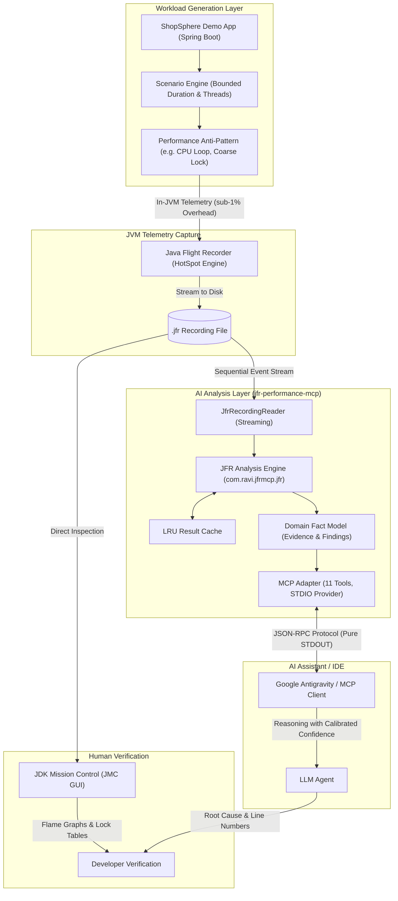
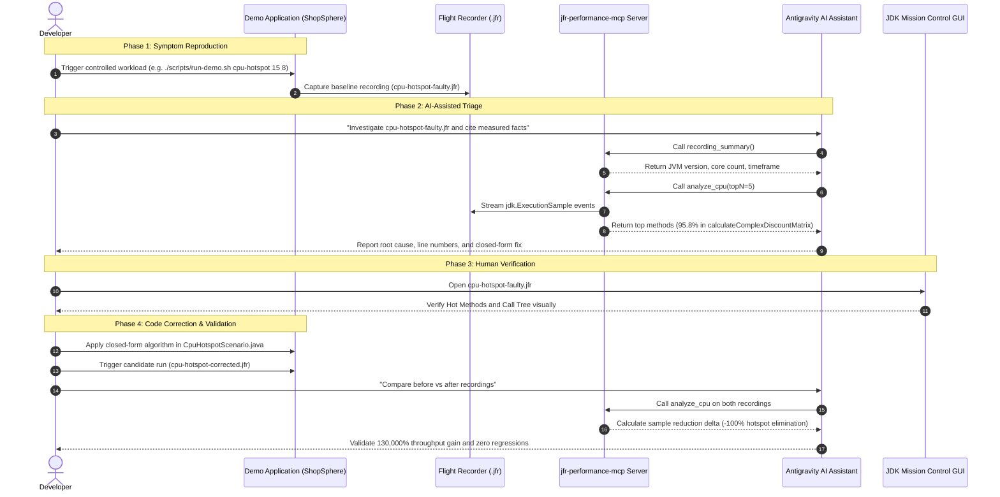

# System Architecture & Data Flow

JFR Performance Lab unites three distinct technical ecosystems:
1. **JVM Runtime Diagnostics** (Java Flight Recorder in OpenJDK)
2. **Visual Desktop Inspection** (JDK Mission Control)
3. **AI Reasoning & Automation** (Model Context Protocol & AI IDEs)

---

## 1. End-to-End System Architecture

This diagram shows how telemetry flows from the running application through the binary flight recorder, across the three-layer MCP engine, and into the AI assistant:

---

## 2. Developer Investigation Workflow: From Symptom to Validated Fix

This diagram illustrates the complete diagnostic loop executed by a developer when troubleshooting a production degradation:

---

## 3. Decoupled Three-Layer MCP Server Design

The `jfr-performance-mcp` server adheres strictly to hexagonal separation:

```mermaid
flowchart LR
    subgraph Layer3["Layer 3: Protocol Transport"]
        MCP_SERVER["JfrMcpServer"]
        STDIO["StdioServerTransportProvider"]
        LOGBACK["Logback (STDERR Only)"]
    end

    subgraph Layer2["Layer 2: Domain Model"]
        EVIDENCE["Evidence Record"]
        FINDING["PerformanceFinding Record"]
        SEVERITY["FindingSeverity"]
    end

    subgraph Layer1["Layer 1: Analysis Engine"]
        ENGINE["JfrAnalysisEngine"]
        STREAMER["JfrRecordingReader"]
        CACHE["InMemoryRecordingAnalysisCache"]
        ANALYZERS["8 Domain Analyzers"]
    end

    Layer3 <-->|"Converts Tools to Domain Calls"| Layer2
    Layer2 <-->|"Structured Finding DTOs"| Layer1
    Layer1 -->|"Safe jdk.jfr.consumer streaming"| JDK_JVM["HotSpot JVM APIs"]
```

### Architectural Key Properties:
- **Engine Purity:** Layer 1 knows nothing about MCP, JSON-RPC, or AI prompt semantics. It can be embedded in any CLI or web backend.
- **Fact Model Immutability:** Layer 2 guarantees that raw measurements are preserved intact without subjective alteration.
- **Protocol Safety:** Layer 3 ensures standard output carries only valid JSON-RPC frames, eliminating communication desync.
