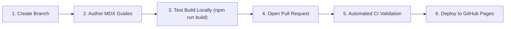

# Contributing to JFR Performance Lab

Thank you for your interest in contributing to **JFR Performance Lab**! We welcome improvements to documentation, new performance scenario guides, and enhancements to the companion MCP tools.

---

## 1. Local Documentation Setup

The documentation website is built with **Docusaurus 3** using **TypeScript** and **Mermaid**.

### Prerequisites
- **Node.js:** Version `20.0.0` or newer (`node -v`)
- **npm:** Version `10.0.0` or newer (`npm -v`)
- **Git:** Version `2.30+`

### Setup Steps

1. Clone the documentation repository:
   ```bash
   git clone https://github.com/rvsoni/jfr-performance-docs.git
   cd jfr-performance-docs
   ```

2. Install dependencies:
   ```bash
   npm install
   ```

3. Launch the local live-reloading development server:
   ```bash
   npm start
   ```
   Open your browser to `http://localhost:3000/jfr-performance-docs/`.

---

## 2. Documentation Contribution Workflow



### Adding or Modifying Scenario Guides
When authoring a new scenario guide in `docs/scenarios/`, ensure you adhere to the **8-step structure**:
1. The performance symptom
2. How to trigger the scenario safely
3. How to capture the recording
4. What to inspect in JMC
5. Which MCP tools to use
6. What the evidence does and does not prove
7. How to inspect and correct the source code
8. How to compare before-and-after measurements

### Testing the Production Build
Before submitting a pull request, always run the full production bundle build to ensure no broken internal links or TypeScript errors exist:

```bash
npm run build
```

You can preview the built static bundle locally with:

```bash
npm run serve
```

---

## 3. Pull Request & Issue Guidelines

- **Issues:** Report bugs, outdated documentation, or suggest new scenario playbooks using the GitHub issue tracker for the respective repository:
  - [jfr-performance-mcp Issues](https://github.com/rvsoni/jfr-performance-mcp/issues)
  - [jfr-performance-demo-app Issues](https://github.com/rvsoni/jfr-performance-demo-app/issues)
  - [jfr-performance-docs Issues](https://github.com/rvsoni/jfr-performance-docs/issues)
- **Pull Requests:** Ensure PR titles follow standard conventional commits (e.g. `docs: add slow-io investigation playbook`, `fix: correct MCP tool schema in reference`).
- **No Hallucinated Benchmarks:** Do not submit fabricated benchmark figures or claim events that have not been verified using a real JFR capture.

---

## 4. Code of Conduct

All contributors and maintainers are expected to adhere to standard open-source community standards:
- Treat all community members with respect and empathy.
- Provide constructive, evidence-based feedback on technical proposals.
- Ensure discussions focus on technical merits and measurable findings.

---

## 5. License Information

- `jfr-performance-mcp` is released under the **Apache License 2.0**.
- `jfr-performance-demo-app` is released under open-source terms.
- Documentation in `jfr-performance-docs` is licensed under the **Apache License 2.0**.
