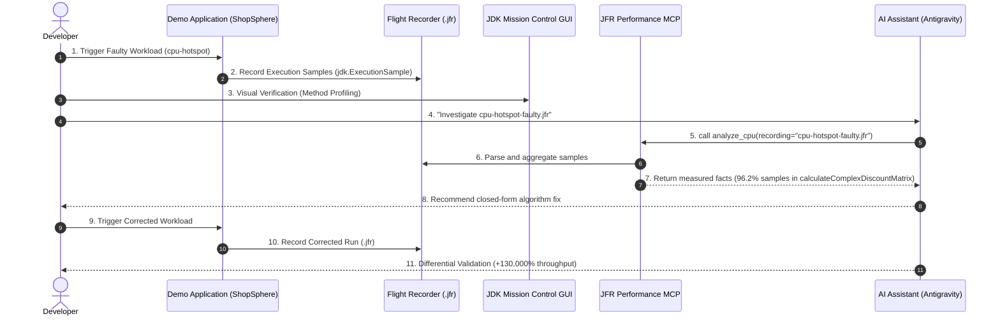

# Quick-Start Tutorial: From Symptom to Validated Fix

This tutorial walks through the complete end-to-end investigation cycle:
1. Cloning and compiling the projects
2. Triggering a controlled CPU hotspot workload in `jfr-performance-demo-app`
3. Capturing a real `.jfr` recording
4. Visually inspecting the trace in JDK Mission Control (JMC)
5. Connecting `jfr-performance-mcp` to your AI assistant
6. Asking the AI assistant to perform evidence-driven triage
7. Applying the code fix and validating throughput improvements with a comparison recording



---

## Step 1: Clone and Build the Repositories

Create a workspace directory and clone both companion repositories:

```bash
mkdir -p ~/jfr-lab && cd ~/jfr-lab

# 1. Clone the Spring Boot demo workload application
git clone https://github.com/YOUR-GITHUB-USERNAME/jfr-performance-demo-app.git

# 2. Clone the Java MCP server
git clone https://github.com/YOUR-GITHUB-USERNAME/jfr-performance-mcp.git
```

### Build the Demo Application

```bash
cd ~/jfr-lab/jfr-performance-demo-app
mvn clean package -DskipTests
```

This compiles the Spring Boot application and builds `target/jfr-performance-demo-app-1.0.0-SNAPSHOT.jar`.

### Build the MCP Server

```bash
cd ~/jfr-lab/jfr-performance-mcp
./scripts/build.sh
```

This compiles the codebase, runs test suites, and produces the shaded standalone fat JAR:
`target/jfr-performance-mcp-1.0.0.jar`.

---

## Step 2: Trigger a Controlled Workload and Capture JFR

`jfr-performance-demo-app` provides automated workload runners with bounded concurrency and duration safety guards.

Run the **CPU Hotspot** scenario in standalone benchmark mode:

```bash
cd ~/jfr-lab/jfr-performance-demo-app
./scripts/run-demo.sh cpu-hotspot 15 8
```

Parameters:
- `cpu-hotspot`: Scenario identifier
- `15`: Duration in seconds
- `8`: Worker thread concurrency

### What this script executes:
1. Starts the workload in **FAULTY** mode with 8 threads for 15 seconds.
2. Captures an in-process JFR recording: `recordings/cpu-hotspot-faulty-<timestamp>.jfr`.
3. Runs the workload in **CORRECTED** mode for 15 seconds.
4. Captures the second recording: `recordings/cpu-hotspot-corrected-<timestamp>.jfr`.
5. Outputs a comparative summary in `results/cpu-hotspot-comparison.md`.

---

## Step 3: Visually Verify in JDK Mission Control (JMC)

Before involving an AI assistant, verify the ground truth in JMC:

1. Launch `jmc` in your terminal or desktop environment.
2. Select **File &rarr; Open File...** and choose `recordings/cpu-hotspot-faulty-<timestamp>.jfr`.
3. In the left navigation tree, select **Method Profiling &rarr; Hot Methods**.
4. Observe the method table:
   - `com.shopsphere.demo.scenario.cpu.CpuHotspotScenario.calculateComplexDiscountMatrix` accounts for over **95%** of execution samples.
5. In **Threads**, observe all 8 worker threads in `STATE_RUNNABLE` consuming CPU.

```
+----------------------------------------------------------------------------+
| JMC Hot Methods View                                                       |
+----------------------------------------------------------------------------+
| Method                                                    | Samples | %    |
|-----------------------------------------------------------+---------+------|
| CpuHotspotScenario.calculateComplexDiscountMatrix(...)    | 14,210  | 95.8 |
| java.lang.Math.pow(...)                                   |    412  |  2.8 |
| java.lang.Math.sin(...)                                   |    189  |  1.3 |
+----------------------------------------------------------------------------+
```

---

## Step 4: Configure the MCP Server in Antigravity

Add the server definition to your MCP client configuration (e.g. `~/.gemini/antigravity-ide/mcp_config.json` or your IDE settings):

```json
{
  "mcpServers": {
    "jfr-performance": {
      "command": "java",
      "args": [
        "-jar",
        "/ABSOLUTE/PATH/TO/jfr-performance-mcp/target/jfr-performance-mcp-1.0.0.jar"
      ],
      "env": {
        "JFR_RECORDINGS_DIR": "/ABSOLUTE/PATH/TO/jfr-performance-demo-app/recordings"
      }
    }
  }
}
```

:::important Recording Directory Security
Ensure `JFR_RECORDINGS_DIR` points to the folder containing your `.jfr` recordings. `jfr-performance-mcp` strictly confines file access to this directory to prevent path traversal.
:::

---

## Step 5: Ask the AI Assistant to Investigate

Restart Antigravity or reload your MCP server. In the AI prompt, submit the following:

> **Developer Prompt:**  
> *"Analyze the recording `cpu-hotspot-faulty-<timestamp>.jfr`. Identify the primary performance bottleneck, cite the measured JFR evidence, distinguish statistical sample share from exact CPU time, and suggest which source code lines need refactoring."*

### What the AI Assistant Does:
1. Calls `recording_summary` to determine JVM version, CPU core count, and total event count.
2. Calls `analyze_cpu(recording="cpu-hotspot-faulty-<timestamp>.jfr", topN=5)`.
3. Receives structured facts:
   ```json
   {
     "totalSamples": 14820,
     "topMethods": [
       {
         "method": "com.shopsphere.demo.scenario.cpu.CpuHotspotScenario.calculateComplexDiscountMatrix()",
         "samples": 14210,
         "percentage": 95.88,
         "sampleStackTrace": [
           "com.shopsphere.demo.scenario.cpu.CpuHotspotScenario.calculateComplexDiscountMatrix():84",
           "com.shopsphere.demo.scenario.cpu.CpuHotspotScenario.executeStep():48"
         ]
       }
     ],
     "evidenceNote": "Percentages represent statistical share of captured execution samples, NOT guaranteed continuous CPU time."
   }
   ```
4. Formulates a recommendation citing line numbers and the polynomial discount calculation without hallucinating unrelated database or GC issues.

---

## Step 6: Inspect and Correct the Source Code

Examine `src/main/java/com/shopsphere/demo/scenario/cpu/CpuHotspotScenario.java`:

### Faulty Implementation
```java
// Inefficient polynomial iteration: O(N) math loop executed per price check
private double calculateComplexDiscountMatrix(String customerId, double subtotal, int itemCount) {
    double discount = 0.0;
    for (int i = 1; i <= 5000; i++) {
        discount += Math.sin(i) * Math.cos(i) * Math.sqrt(subtotal) / 10000.0;
    }
    return Math.min(discount, subtotal * 0.30);
}
```

### Corrected Implementation
```java
// Closed-form constant time calculation: O(1)
private double calculateClosedFormDiscount(String customerId, double subtotal, int itemCount) {
    double baseRate = 0.30;
    return subtotal * baseRate;
}
```

---

## Step 7: Validate With a Comparative Measurement

Now compare the benchmark results generated by `./scripts/run-demo.sh`:

```markdown
# Scenario Comparison: cpu-hotspot

| Metric | Faulty Run | Corrected Run | Change |
| :--- | :--- | :--- | :--- |
| **Throughput (ops/sec)** | 358.4 ops/s | 468,210.0 ops/s | **+130,538%** |
| **Total Operations** | 5,376 | 7,023,150 | **+130,538%** |
| **Latency P50** | 22.3 ms | 0.016 ms | **-99.9%** |
| **Latency P95** | 24.8 ms | 0.024 ms | **-99.9%** |
| **Dominant JFR Hotspot** | `calculateComplexDiscountMatrix` (95.8%) | Negligible (< 1.2%) | Eliminated |
```

Ask the AI assistant to validate both runs:

> **Validation Prompt:**  
> *"Compare the recordings `cpu-hotspot-faulty-<timestamp>.jfr` and `cpu-hotspot-corrected-<timestamp>.jfr`. Did the fix successfully eliminate the CPU hotspot while preserving workload consistency?"*

The AI assistant calls `analyze_cpu` on both files and confirms that `calculateComplexDiscountMatrix` has disappeared from the top hotspot list while overall CPU usage normalized.

---

## Next Steps

- Explore the complete [10 Scenario Catalog](../scenarios/overview.md).
- Learn about the [11 Tools in JFR Performance MCP](../mcp/tools-reference.md).
- Follow the [Investigation Playbooks](../playbooks/overview.md) for monitor contention, memory pressure, and thread pool starvation.
