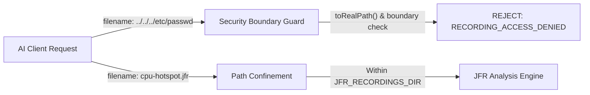

# Configuration & Security

`jfr-performance-mcp` is designed to run securely inside developer workstations and automated CI environments without exposing operating system access to AI models.

---

## Environment Variables

| Variable | Default Value | Description |
| :--- | :--- | :--- |
| `JFR_RECORDINGS_DIR` | `./recordings` | Canonical absolute or relative path to the directory containing `.jfr` recording files. |
| `LOG_LEVEL` | `INFO` | Internal logging verbosity (`DEBUG`, `INFO`, `WARN`, `ERROR`). All logs route to `STDERR`. |
| `JFR_CACHE_MAX_ENTRIES` | `20` | Maximum number of parsed `.jfr` recordings retained in the LRU in-memory cache. |

### Example Shell Configuration

```bash
export JFR_RECORDINGS_DIR="/home/developer/workspace/recordings"
export LOG_LEVEL="INFO"
```

---

## Security Boundaries and Sandboxing

Because AI assistants generate arguments for MCP tool calls, `jfr-performance-mcp` implements defense-in-depth isolation:



### 1. Recording Directory Confinement
All file lookups are restricted to the base directory configured in `JFR_RECORDINGS_DIR`. The server resolves the canonical path of the configured directory upon initialization.

### 2. Path Traversal Prevention
Any client request providing paths containing `..` or attempting to traverse into parent directories is immediately intercepted and rejected with a structured error:

```json
{
  "isError": true,
  "errorCode": "RECORDING_ACCESS_DENIED",
  "message": "Access denied: Recording path escapes configured recording directory."
}
```

### 3. Symlink Escape Protection
Before opening any file, the server evaluates `Path.toRealPath()` against the canonical root directory. Symbolic links pointing outside the configured directory tree are rejected.

### 4. Read-Only Operation
The server contains **no administrative tools**. It cannot:
- Restart or terminate JVM processes
- Execute shell scripts or operating system binaries
- Modify JVM startup flags or environment variables
- Delete or overwrite `.jfr` recordings

---

## Transport Isolation: Pure STDIO Protocol

The Model Context Protocol uses standard input and output (`STDIO`) for JSON-RPC frame exchange.

:::danger STDOUT Corruption Risk
If any diagnostic log statement, JVM banner, or exception stack trace is written to `STDOUT`, the JSON-RPC parser in the MCP client (Antigravity, Claude Desktop, Cursor) will fail with syntax errors and drop the connection.
:::

`jfr-performance-mcp` enforces strict isolation using Logback:

1. **`STDOUT`**: Reserved exclusively for valid JSON-RPC 2.0 frames produced by the official MCP Java SDK.
2. **`STDERR`**: All internal engine logs, parsing progress, cache hits/misses, and diagnostic information are redirected to standard error.

### Logback Configuration (`logback.xml`)
```xml
<configuration>
    <appender name="STDERR" class="ch.qos.logback.core.ConsoleAppender">
        <target>System.err</target>
        <encoder>
            <pattern>%d{HH:mm:ss.SSS} [%thread] %-5level %logger{36} - %msg%n</pattern>
        </encoder>
    </appender>
    <root level="INFO">
        <appender-ref ref="STDERR" />
    </root>
</configuration>
```

---

## Memory & JVM Heap Sizing

Large production `.jfr` recordings (e.g. 50 MB to 500 MB) contain millions of events. 

While `JfrRecordingReader` streams events sequentially to avoid memory bloat, aggregations and call trees require temporary in-memory data structures.

Recommended JVM startup flags for the MCP server:

```bash
java -Xms512m -Xmx2g -XX:+UseG1GC -jar target/jfr-performance-mcp-1.0.0.jar
```

- `-Xmx2g`: Generous heap headroom for aggregating deep call trees.
- `-XX:+UseG1GC`: Low pause collector for responsive tool call execution.
