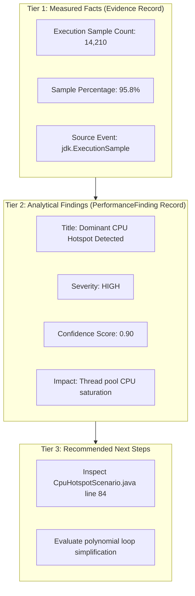

# Evidence, Confidence & Limitations

A core requirement of AI-assisted JVM diagnostics is ensuring that models do not confuse **measured runtime facts** with **speculative hypotheses**.

---

## The Three-Tier Information Model

`jfr-performance-mcp` models diagnostics across three distinct tiers:

### 1. Facts (`Evidence` Record)
Represents immutable, verifiable measurements extracted directly from JFR event streams:
- `metric`: Machine-readable identifier (e.g., `methodCpuSamplePercentage`, `blockedTimeMs`, `gcPauseTotalMs`)
- `value`: Measured numerical quantity
- `unit`: Precise unit of measure (`percent_samples`, `milliseconds`, `bytes`, `count`)
- `source`: Originating JFR event type (e.g., `jdk.ExecutionSample`, `jdk.JavaMonitorEnter`)
- `confidence`: Assessment of measurement precision (0.0 to 1.0)
- `description`: Plain-text factual summary

### 2. Findings (`PerformanceFinding` Record)
Synthesizes one or more facts into a diagnosis:
- `category`: `CPU`, `GC`, `ALLOCATION`, `THREAD`, `LOCK_CONTENTION`, `EXCEPTION`, `IO`, `LATENCY`
- `severity`: Standardized classification scale:
  - `CRITICAL`: System-halting bottlenecks (e.g., STW pause > 1000ms, heap exhaustion)
  - `HIGH`: Major throughput degradations or >80% resource saturation
  - `MEDIUM`: Noticeable inefficiency (e.g., elevated lock waits, minor allocation churn)
  - `LOW`: Slight variance within acceptable operating envelopes
  - `INFO`: Normal operational telemetry
- `confidence`: Probabilistic confidence (e.g., 0.85 = 85%)
- `evidence`: Array of underlying `Evidence` records

### 3. Recommendations
Concrete source-code actions and investigative paths for the human engineer to review.

---

## Calibrated Confidence Language

To prevent AI assistants from overstating their certainty, tool findings utilize calibrated phrasing:

| Confidence Range | Calibrated Phrasing | Interpretation |
| :--- | :--- | :--- |
| **0.85 – 1.00** | *"Strong evidence indicates..."* | Supported by multiple high-frequency JFR events and corroborated metrics. |
| **0.65 – 0.84** | *"Likely bottleneck identified in..."* | Primary metric is elevated, but secondary corroboration is limited. |
| **0.40 – 0.64** | *"Possible contributing factor..."* | Elevated events observed, but workload duration or sample count is low. |
| **< 0.40** | *"No significant evidence found..."* | Metrics fall within healthy baseline thresholds. |

---

## Technical Limitations & Boundaries

### 1. Sampled Nature of JFR Telemetry
- **Execution Profiling:** `jdk.ExecutionSample` uses statistical thread program counter sampling (typically every 10ms–20ms). A method accounting for 80% of samples was found running during 80% of sample ticks. While this strongly correlates with CPU consumption, it is **not** an exact nanosecond timer of thread CPU execution.
- **Allocation Profiling:** `jdk.ObjectAllocationSample` samples allocations when threads take new Thread-Local Allocation Buffers (TLABs) or allocate large objects directly into Old Gen. It reveals dominant allocation sites without tracking every 16-byte object.

### 2. Absence of Evidence Is Not Proof of Absence
If an event type is disabled in the JFR recording profile (for example, if socket I/O thresholds are set higher than request durations or network events are disabled), the MCP tool reports zero socket events. 
The AI assistant must not conclude that *"no network calls took place"*; rather, it must state that *"no socket events exceeded the recording profile's threshold."*

### 3. Application Latency Context
JFR measures in-JVM execution: method execution samples, monitor enter blocks, GC pauses, and file/socket waits. JFR cannot automatically measure end-to-end client HTTP perceived latency or downstream database query runtimes unless custom application events (`jdk.jfr.Event`) or OpenTelemetry tracing spans are emitted into the recording.

### 4. Human Verification Requirement
AI-generated diagnostic conclusions are advisory recommendations. Production JVM optimizations, algorithmic modifications, and thread pool adjustments must always be verified through code review and staging performance tests.
