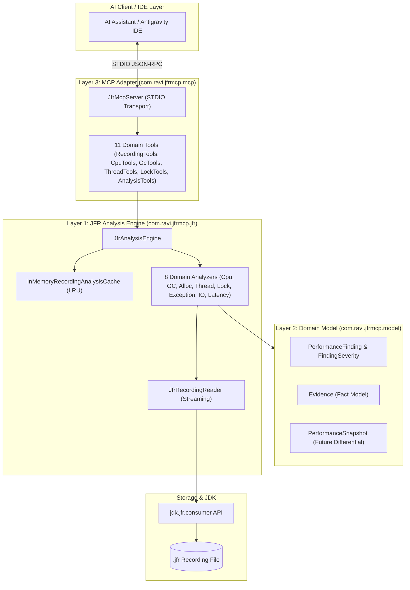

# JFR Performance MCP: Project Overview & Architecture

`jfr-performance-mcp` is an enterprise-grade Model Context Protocol (MCP) server built with Java 21 and the official MCP Java SDK. It enables AI assistants to inspect Java Flight Recorder (`.jfr`) recordings and answer production JVM performance questions using **measured runtime facts** rather than speculative guesswork.

---

## The Central Design Principle

> **DO NOT ask the LLM to guess JVM problems.**  
> **Give the LLM structured JVM evidence through MCP tools.**

LLMs excel at pattern recognition, code analysis, and architectural reasoning—but they fail when asked to guess why a production JVM is slow based solely on high-level symptom descriptions or stack traces.

`jfr-performance-mcp` provides a structured evidence layer that extracts measured facts (CPU samples, monitor contention timings, GC pause durations, allocation rates, and thread states) and presents them to the AI model so it can reason with verifiable confidence.

---

## Three-Layer Architecture

The server adheres to a strict decoupling between low-level JFR event extraction, business domain abstractions, and AI protocol transport:

### Layer 1: JFR Analysis Engine (`com.ravi.jfrmcp.jfr`)
- **Zero MCP Knowledge**: Contains no references to JSON-RPC, MCP SDK, or prompt templates.
- **Sequential Streaming**: Uses `JfrRecordingReader` wrapping `jdk.jfr.consumer.RecordingFile` to safely iterate events without exhausting JVM heap memory on large recording files.
- **LRU Analysis Cache**: `InMemoryRecordingAnalysisCache` caches parsed results keyed by canonical file path, file size, and last modified timestamp, making interactive multi-tool AI queries instantaneous.
- **Domain Analyzers**: Discrete analyzers for each performance dimension (`CpuAnalyzer`, `GarbageCollectionAnalyzer`, `AllocationAnalyzer`, `ThreadAnalyzer`, `LockAnalyzer`, `ExceptionAnalyzer`, `IoAnalyzer`, `LatencyAnalyzer`).

### Layer 2: Domain Model (`com.ravi.jfrmcp.model`)
- Immutable Java records representing JVM performance domain concepts.
- **`Evidence`**: Unambiguous facts with measurement metrics, values, units, sources (e.g. `jdk.ExecutionSample`), and confidence ratings.
- **`PerformanceFinding`**: Structured findings with severity (`CRITICAL`, `HIGH`, `MEDIUM`, `LOW`, `INFO`), impact analysis, and investigation next steps.
- **Strict Separation**: Cleanly separates **FACTS** from **INTERPRETATIONS** and **RECOMMENDATIONS**.

### Layer 3: MCP Adapter (`com.ravi.jfrmcp.mcp`)
- Implements the official MCP Java SDK with `StdioServerTransportProvider`.
- **Pure STDOUT Protocol Isolation**: All internal diagnostic logs are routed strictly to `STDERR` via Logback, ensuring `STDOUT` carries only pure JSON-RPC protocol frames.
- **Structured Error Handling**: Returns typed error payloads (`isError: true` with error codes like `RECORDING_NOT_FOUND` or `RECORDING_ACCESS_DENIED`).
- **Prompt Engineering**: Every tool includes detailed parameter descriptions and instructions instructing the LLM on evidence interpretation.

---

## Security Boundaries

1. **Recording Directory Confinement**: All file reads are strictly restricted to the configured `JFR_RECORDINGS_DIR` base folder (default `./recordings`).
2. **Path Traversal Prevention**: Any request containing directory traversal sequences (`..`) is blocked immediately.
3. **Symlink Escape Protection**: Validates canonical paths using `toRealPath()` to prevent escaping via symbolic links.
4. **Strictly Read-Only**: The server contains no tools to restart JVMs, modify runtime flags, kill processes, or execute arbitrary operating system commands.

---

## Status and Planned Capabilities

| Capability | Status | Implementation Details |
| :--- | :--- | :--- |
| 11 Core MCP Diagnostic Tools | **Implemented** | Full implementation using `jdk.jfr.consumer` |
| LRU In-Memory Caching | **Implemented** | Keyed on path, file size, and timestamp |
| STDIO Transport Protocol | **Implemented** | Official MCP Java SDK with STDERR log routing |
| Security Confinement | **Implemented** | Canonical path and symlink boundary checks |
| Differential Comparison (`compare_recordings`) | **Planned** | Data model ready (`PerformanceSnapshot`), tool pending |
| JMC Core Rules Engine Integration | **Planned** | Extension interface ready (`JfrAdvancedAnalyzer`) |
| Live JFR Stream Ingestion | **Planned** | `JfrDataSource` abstraction ready for `EventStream` |
