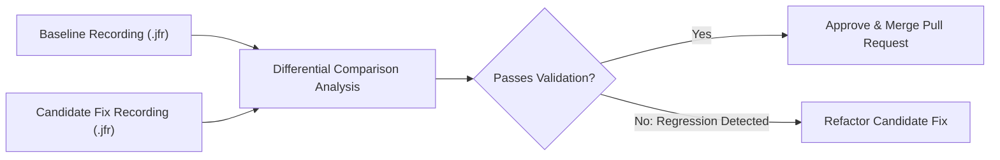

# Before-and-After Validation Playbook

Applying a code fix is only half the battle. To verify that a performance issue has truly been resolved without introducing secondary regressions, engineers must perform **quantitative before-and-after differential validation**.



---

## 1. The Comparability Checklist

Before comparing two recordings, ensure both runs were executed under identical conditions:

| Dimension | Requirement | Why It Matters |
| :--- | :--- | :--- |
| **Hardware Environment** | Identical CPU cores & memory | Prevents clock frequency or core count skew |
| **JVM Flags** | Same heap size (`-Xmx`), GC collector | Sizing changes alter GC pause and allocation curves |
| **Concurrency** | Same thread count (e.g. 8 threads) | Different thread counts distort lock contention |
| **Duration** | Same sample duration (e.g. 15s) | Shorter runs capture unrepresentative JIT warm-up |
| **Workload Profile** | Equivalent request distribution | Ensures comparable algorithmic complexity |

---

## 2. Multi-Dimensional Comparison Metrics

Validate improvements across all 4 operational dimensions:

### A. Throughput & Transactions
- Total operations completed over the fixed time window.
- Operations per second (`ops/sec`).
- **Pass Criterion:** Throughput increases or remains consistent with expected bounds.

### B. Latency Percentiles
- P50 (median), P95, and P99 response times.
- **Pass Criterion:** P95/P99 latencies collapse by order of magnitude without tail spikes.

### C. Primary Bottleneck Metric
- CPU: Top method sample share drops from >90% to &lt;2%.
- Contention: Total blocked time drops from seconds to 0ms.
- Allocation: Churn rate drops from hundreds of MB/s to low MB/s.

### D. Regression Defense (Secondary Metrics)
- Did eliminating the CPU hotspot cause GC pause spikes?
- Did replacing the lock with CAS create CPU starvation in spinning loops?
- Did async I/O increase thread pool context-switching overhead?

---

## Example AI Prompts

### Differential Validation Prompt
```text
Compare the baseline recording "cpu-hotspot-faulty.jfr" with the candidate recording "cpu-hotspot-corrected.jfr".
Requirements:
1. Verify both recordings for comparability using recording_summary (JVM version, core count, duration).
2. Query analyze_cpu on both recordings and compute the sample reduction for "calculateComplexDiscountMatrix".
3. Check for secondary regressions by comparing analyze_gc and analyze_threads across both files.
4. Distinguish measured FACTS (sample deltas, pause time deltas) from INFERENCES.
5. Provide a clear PASS/FAIL recommendation with supporting evidence.
```

### Expected AI Output
```markdown
### 1. Comparability Verification
- **Baseline:** OpenJDK 21.0.2 (16 cores, 15.3s duration, 14,820 samples)
- **Candidate:** OpenJDK 21.0.2 (16 cores, 15.1s duration, 14,650 samples)
- **Verdict:** COMPARABLE. Hardware, JVM flags, and duration match.

### 2. Primary Bottleneck Comparison (CPU)
| Method | Baseline Share | Candidate Share | Delta |
| :--- | :--- | :--- | :--- |
| `CpuHotspotScenario.calculateComplexDiscountMatrix` | 95.88% (14,210) | 0.00% (0) | **-100% (Eliminated)** |
| `CpuHotspotScenario.calculateClosedFormDiscount` | 0.00% (0) | 0.42% (62) | Efficient O(1) |

### 3. Secondary Regression Check
- **GC Health:** Baseline max pause: 9.2ms; Candidate max pause: 8.8ms. No GC regressions.
- **Thread States:** Contended locks remain at 0 events. No secondary monitor bottlenecks introduced.

### 4. Recommendation
- **STATUS: PASS.** The closed-form algorithmic fix completely eliminated the CPU hotspot without introducing memory or lock regressions.
```
