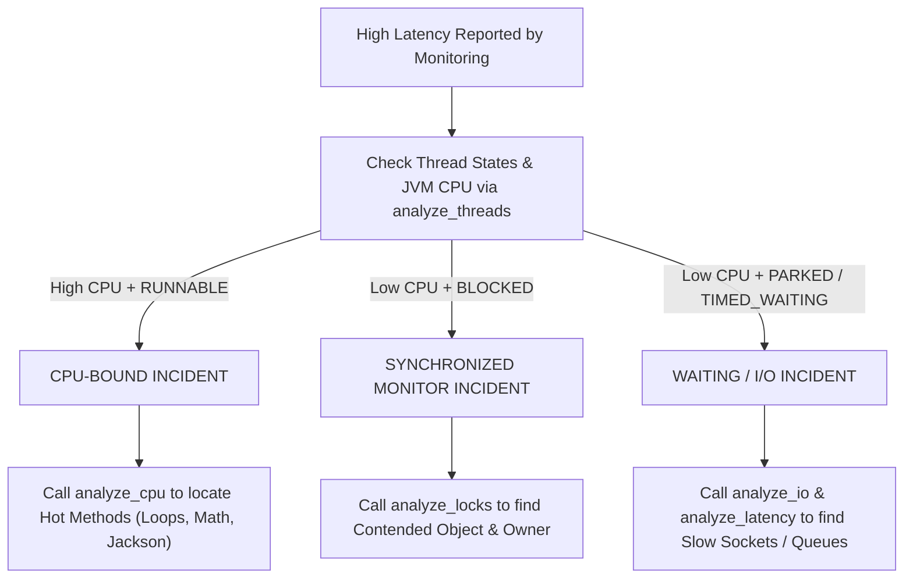

# Blocked vs. CPU-Bound Investigation Playbook

When investigating an application slowdown, the first and most critical branch in the diagnostic tree is determining:
> **Are worker threads actively burning CPU cycles, or are they stalled waiting off-CPU?**

Misdiagnosing this leads to disastrous engineering decisions—such as vertically scaling CPU cores when threads are actually stalled on a lock or downstream network call.

---

## The Thread State Classification Tree



---

## Comparison Matrix

| Characteristic | CPU-Bound | Synchronized Monitor Blocked | Off-CPU Waiting / Parked |
| :--- | :--- | :--- | :--- |
| **JVM CPU Load** | **High** (70% – 100%) | **Low** (5% – 20%) | **Near Zero** (1% – 5%) |
| **Dominant Thread State** | `STATE_RUNNABLE` | `BLOCKED` | `WAITING` / `TIMED_WAITING` |
| **Dominant JFR Events** | `jdk.ExecutionSample` | `jdk.JavaMonitorEnter` | `jdk.ThreadPark`, `jdk.SocketRead` |
| **Typical Root Causes** | Complex math loops, regex catastrophic backtracking, Jackson roundtrips, exception storms | Coarse `synchronized` methods, global database connection lock | Slow downstream microservice, thread pool queue starvation, database query wait |
| **Primary MCP Tool** | `analyze_cpu` | `analyze_locks` | `analyze_threads`, `analyze_io`, `analyze_latency` |
| **Wrong Remedy** | Increasing thread pool size (worsens context switching) | Adding CPU cores (does not help single-threaded lock) | Optimizing algorithms (code isn't running) |

---

## Step-by-Step Diagnostic Protocol

### 1. Query Overall Thread States
Call `analyze_threads`:

```text
Tool: analyze_threads(recording="recording.jfr")
```

Look at the breakdown:
- If `activeThreadCount` == `blockedThreads`: Monitor contention is your primary blocker.
- If `parkedThreads` >> runnable threads and CPU is low: Look for thread pool starvation or downstream blocking I/O.
- If `activeThreadCount` are runnable and CPU load is high: Proceed with CPU Hotspot analysis.

### 2. Follow the Specialized Branch
- **If Runnable:** Run `analyze_cpu` with `topN=10`.
- **If Blocked:** Run `analyze_locks` with `topN=5`.
- **If Parked/Waiting:** Run `analyze_latency(thresholdMs=50.0)` and `analyze_io`.

---

## Example AI Prompts

### Classification Prompt
```text
Triage recording "incident-run.jfr" to determine whether the bottleneck is CPU-bound or off-CPU waiting.
Requirements:
1. Call analyze_threads, recording_summary, and analyze_latency.
2. Report the breakdown of thread states (runnable, blocked, waiting, parked).
3. Classify the incident as CPU-BOUND, LOCK-BLOCKED, or OFF-CPU WAITING based strictly on measured JFR evidence.
4. List the dominant JFR event types supporting this classification.
5. Direct the developer to the correct specialized investigation tool.
```

### Expected AI Output
```markdown
### 1. Measured Thread Telemetry
- **Total Threads:** 24
- **Active Threads:** 18
- **Runnable Threads:** 2 (11%)
- **Blocked Threads:** 12 (67%)
- **Parked / Waiting Threads:** 4 (22%)
- **JVM User CPU:** 14.2% across 8 cores.

### 2. Classification: LOCK-BLOCKED (Off-CPU Monitor Contention)
- The majority of worker threads (67%) are in the `BLOCKED` state.
- Because CPU utilization is low (14.2%), the system is **not** CPU-bound.
- The dominant JFR event driving latency is `jdk.JavaMonitorEnter`.

### 3. Immediate Next Steps
- Do not attempt to optimize loops or scale worker thread pools.
- Run `analyze_locks(recording="incident-run.jfr")` to locate the contested monitor object and stack traces.
```
