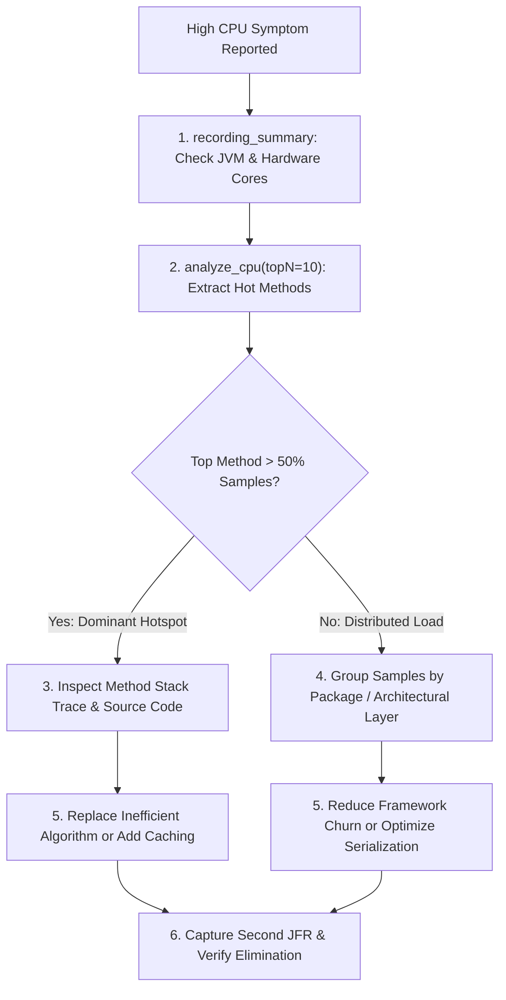

# CPU Investigation Playbook

This playbook outlines how to diagnose and resolve high CPU consumption using JFR execution profiling and AI assistants.

---

## The Diagnostic Flowchart



---

## Step 1: Discover High-Level CPU Metrics

Ask the MCP server for recording metadata to understand the JVM hardware environment:

```text
Tool: recording_summary(recording="recording.jfr")
```

Check:
- `cpuCount`: How many logical CPU cores are available?
- `durationSeconds`: Over how long of an interval was the recording captured?
- Total `jdk.ExecutionSample` events.

---

## Step 2: Query Execution Samples

Invoke `analyze_cpu`:

```text
Tool: analyze_cpu(recording="recording.jfr", topN=10)
```

### Key Metrics to Evaluate:
- `percentage`: Share of captured execution ticks. If one application method represents **>60%** of samples, you have a classic localized algorithmic hotspot.
- `averageJvmUserCpu`: Total CPU utilization during the window (e.g. 0.85 = 85%).
- `sampleStackTrace`: Immediate callers leading to the hotspot.

:::tip Execution Samples vs. Continuous CPU Time
Execution samples are recorded at discrete thread timer intervals (typically 10ms–20ms). A method with 90% of samples was found actively running on the CPU core during 90% of sampling ticks. It is a statistical distribution, not a cumulative wall-clock stopwatch.
:::

---

## Example AI Prompts

### Discovery Prompt
```text
Analyze the CPU performance of recording "cpu-hotspot-faulty.jfr".
Requirements:
1. Call analyze_cpu with topN=5.
2. Report the top 3 hotspot methods with their exact sample count and percentage.
3. Distinguish between measured sample share and continuous CPU time.
4. Separate the measured FACTS from your HYPOTHESES regarding code inefficiency.
5. Provide the stack trace lines where the hotspot originates.
```

### Expected AI Output
```markdown
### 1. Measured Facts (JFR Evidence)
- **Top Hotspot:** `com.shopsphere.demo.scenario.cpu.CpuHotspotScenario.calculateComplexDiscountMatrix()`
- **Sample Count:** 14,210 of 14,820 total execution samples.
- **Sample Share:** **95.88%** of all thread execution samples.
- **Average JVM User CPU:** 88.0% across 16 CPU cores.
- **Origination Frame:** `CpuHotspotScenario.java:84` called by `executeStep()` at line 48.

### 2. Hypotheses (Analysis)
- Based on the concentration in `calculateComplexDiscountMatrix()`, the thread pool is CPU-bound on this single calculation.
- The high sample count indicates compute-intensive mathematical loops or unmemoized evaluations rather than blocked threads.

### 3. Recommended Source Code Audit
- Open `CpuHotspotScenario.java` at line 84.
- Inspect loop boundaries and mathematical functions (`Math.sin`, `Math.cos`).
- Replace iterative evaluation with an O(1) closed-form calculation or cache recurring inputs.
```

---

## Verification Checklist

- [ ] Top method verified in JMC **Method Profiling &rarr; Hot Methods**.
- [ ] Confirmed thread state is `STATE_RUNNABLE` (not blocked waiting).
- [ ] Applied code optimization.
- [ ] Captured post-fix recording and verified method samples dropped to &lt;2%.
