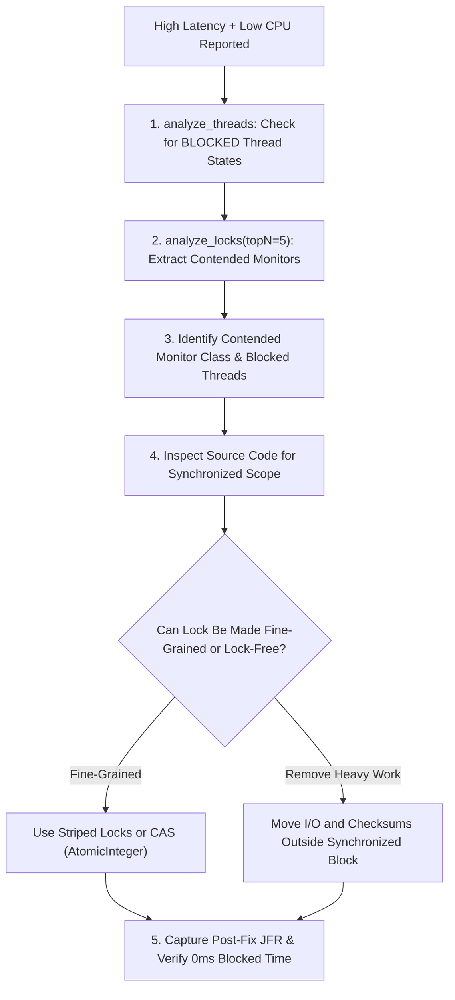

# Monitor Contention Playbook

This playbook provides a systematic approach to identifying and resolving thread serialization bottlenecks caused by Java `synchronized` monitors.

---

## The Contention Investigation Cycle



---

## Step 1: Detect Blocked Thread States

In monitor contention, threads are not active on CPU—they are suspended by the operating system waiting for the lock owner to exit the monitor:

```text
Tool: analyze_threads(recording="recording.jfr")
```

Verify if `blockedThreads` is greater than 0, and compare it against the total active thread count.

---

## Step 2: Query Monitor Contention Details

Call `analyze_locks`:

```text
Tool: analyze_locks(recording="recording.jfr", topN=5)
```

### Metrics to Extract:
- `totalBlockedDurationMs`: Cumulative time across all worker threads spent blocked.
- `maxBlockedTimeMs`: Longest single blocking event (e.g., 150ms).
- `blockedThreads`: How many concurrent threads were stalled.
- `monitorClass`: Object class being locked (e.g. `java.lang.Object`).
- `contendingThreads`: Names of worker threads queueing on the lock.

---

## Example AI Prompts

### Contention Diagnosis Prompt
```text
Investigate recording "thread-contention-faulty.jfr" for thread contention bottlenecks.
Requirements:
1. Call analyze_locks and analyze_threads.
2. Report the total blocked duration in milliseconds and the number of contending threads.
3. Identify the monitor class and affected service methods.
4. Distinguish the measured FACTS (wait durations, thread counts) from HYPOTHESES (architectural reasons for contention).
5. State what the evidence does NOT prove regarding race conditions or data safety.
6. Propose a thread-safe remediation (e.g. CAS or lock striping).
```

### Expected AI Output
```markdown
### 1. Measured Facts (JFR Evidence)
- **Contention Events:** 248 `jdk.JavaMonitorEnter` events recorded.
- **Total Blocked Time:** 14,210.5 ms across 8 worker threads.
- **Max Single Wait:** 112.4 ms.
- **Contended Object:** `java.lang.Object` associated with `InventoryService`.
- **Thread State:** 8 worker threads spending 78% of time in `BLOCKED` state.

### 2. Hypotheses (Analysis)
- The high cumulative blocked time indicates that all concurrent transactions are funneling through a single coarse mutual-exclusion lock.
- Because CPU utilization is low, worker threads are stalled waiting on OS monitor releases rather than doing productive computation.

### 3. Limitations of the Evidence
- The JFR evidence proves that `InventoryService` is serializing threads.
- The evidence does *not* prove that removing the lock is safe; the developer must ensure thread safety via atomic CAS operations or concurrent collections.

### 4. Remediation Options
- Replace `synchronized (globalMonitor)` with `ConcurrentHashMap<String, AtomicInteger>` using `AtomicInteger.compareAndSet()`.
- Move any artificial delays or checksum computations outside the critical section.
```

---

## Verification Checklist

- [ ] Identified the contested lock in JMC **Threads &rarr; Lock Instances**.
- [ ] Confirmed source-code lock boundaries in target service.
- [ ] Replaced coarse synchronization with lock-free atomic CAS or fine-grained keys.
- [ ] Verified post-fix recording shows `totalContentionEvents: 0`.
