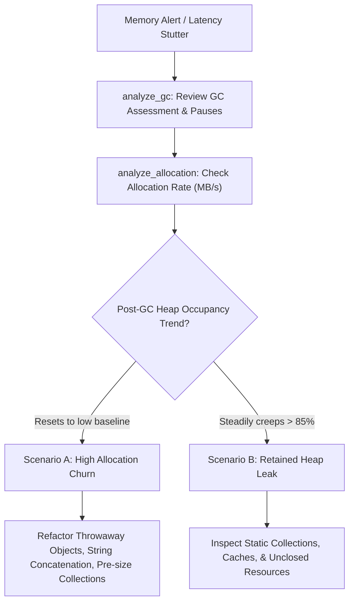

# Allocation & GC Investigation Playbook

This playbook guides engineers through investigating memory-related performance regressions, distinguishing between **allocation churn** (short-lived object churn) and **memory leaks** (retained heap growth).

---

## Memory Diagnostic Matrix: Churn vs. Leak



| Dimension | High Allocation Churn | Retained Memory Leak |
| :--- | :--- | :--- |
| **Primary Symptom** | Elevated Young Gen GC frequency, CPU spikes in GC worker threads | Gradual rise in Old Gen occupancy, eventual `OutOfMemoryError` |
| **Post-GC Heap Level** | **Low and stable** (objects quickly reclaimed) | **Monotonically increasing** |
| **GC Collection Type** | Frequent Young GCs (e.g. 5–10 per second) | Frequent Full / Old Gen GCs; long STW pauses |
| **Dominant Classes** | `byte[]`, `String`, `StringBuilder`, `HashMap$Node` | Domain entities, cached sessions, leaked listeners |
| **Typical Fix** | Reuse buffers, avoid intermediate DTOs, pre-size buffers | Eviction policies, weak references, fix static retention |

---

## Step 1: Evaluate GC Health

Call `analyze_gc`:

```text
Tool: analyze_gc(recording="recording.jfr")
```

Evaluate:
- `assessment`: `LOW`, `MEDIUM`, `HIGH`, or `CRITICAL`
- `maxPauseMs`: Maximum Stop-The-World (STW) pause duration (concern if >200ms)
- `totalPauseMs`: Total STW duration during recording window
- `youngGcCount` vs. `oldGcCount`: Elevated young GCs indicate churn; old GCs indicate tenured pressure

---

## Step 2: Evaluate Allocation Pressure

Call `analyze_allocation`:

```text
Tool: analyze_allocation(recording="recording.jfr", topN=5)
```

Evaluate:
- `estimatedAllocationRateMbPerSec`: Churn rate (e.g., >300 MB/sec is heavy)
- `topAllocatingClasses`: Which classes generate the most bytes?
- `estimationNote`: Remind the model that allocations are sampled at TLAB boundaries

---

## Example AI Prompts

### Allocation & GC Triage Prompt
```text
Evaluate recording "allocation-pressure-faulty.jfr" for memory and GC efficiency.
Requirements:
1. Query analyze_gc and analyze_allocation.
2. Report the estimated allocation rate in MB/s and top 3 allocating classes.
3. Report total GC pause time and maximum pause duration.
4. State whether the evidence indicates allocation churn or a permanent memory leak.
5. Provide actionable code changes to reduce allocation pressure.
```

### Expected AI Output
```markdown
### 1. Measured Facts (JFR Evidence)
- **Estimated Allocation Rate:** 412.5 MB/sec.
- **Top Allocating Classes:**
  1. `java.lang.String` (50.0% of sampled bytes)
  2. `java.util.HashMap$Node` (25.0% of sampled bytes)
  3. `byte[]` (18.5% of sampled bytes)
- **GC Pauses:** 18 Young Gen collections; Max pause: 14.2 ms; Total pause: 145.0 ms.
- **Old Gen Collections:** 0 Old/Full GC events recorded.
- **GC Health Assessment:** LOW / MEDIUM (individual pauses are short).

### 2. Analytical Hypotheses
- **Churn, Not a Leak:** Because Old Gen collections are zero and pause durations remain sub-15ms, heap memory is being promptly reclaimed. The issue is purely allocation churn in hot loops.
- High String and HashMap$Node volume suggests intermediate DTO and String transformation churn in business logic.

### 3. Recommended Remediation
- Inspect methods creating throwaway `HashMap` or string concatenation.
- Replace string `+` operators with a pre-sized `StringBuilder`.
- Avoid instantiating temporary maps for summary aggregations.
```
