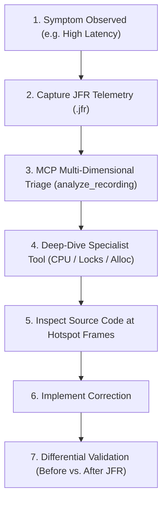

# Investigation Playbooks: Methodology & AI Prompting

The goal of the **Investigation Playbooks** is to turn ad-hoc, guessing-based performance debugging into a repeatable, evidence-driven scientific process.



---

## The Golden Rule: Observations vs. Hypotheses

When prompting an AI assistant or writing a post-mortem diagnostic report, enforce strict separation between:

1. **Measured Observations (Facts):** Quantifiable data extracted from JFR events (e.g., *"Method `calculatePrice` accounts for 95.8% of sampled execution ticks"*).
2. **Analytical Hypotheses (Inferences):** Probabilistic explanations for why the metric is elevated (e.g., *"The method likely runs an unoptimized O(N) loop with redundant trigonometric functions"*).
3. **Recommended Actions:** Source-code or architectural adjustments to validate or fix the issue.

---

## Universal Prompt Structure for AI Assistants

To prevent your AI model from hallucinating or guessing, use this structured prompt pattern:

```text
You are investigating a JVM performance issue using the JFR Performance MCP tools.
Recording: "<RECORDING_FILE_NAME>.jfr"

Rules for this investigation:
1. Do not make assumptions or propose code changes until you have queried JFR tools for measured runtime evidence.
2. Clearly distinguish FACTS (measured sample percentages, lock wait milliseconds, pause durations) from HYPOTHESES (inferences about the code).
3. If an event type is missing or zero, note whether the recording profile captured it rather than assuming the activity did not occur.
4. Provide the exact MCP tool calls you used and cite the metric values they returned.
```

---

## Playbook Catalog

| Playbook | Target Bottleneck | Primary Tools |
| :--- | :--- | :--- |
| [**CPU Investigation**](cpu-playbook.md) | High CPU saturation, compute hotspots | `analyze_cpu`, `recording_summary` |
| [**Monitor Contention**](lock-contention-playbook.md) | Latency spikes, blocked threads, lock serialization | `analyze_locks`, `analyze_threads` |
| [**Allocation & GC**](memory-gc-playbook.md) | GC pauses, memory churn, allocation rate | `analyze_allocation`, `analyze_gc` |
| [**Blocked vs. CPU-Bound**](blocked-vs-cpu-playbook.md) | High latency with low CPU, thread state classification | `analyze_threads`, `analyze_latency` |
| [**Before-and-After Validation**](before-after-validation.md) | Validating fixes, regression testing | `analyze_cpu`, `analyze_locks`, delta |
