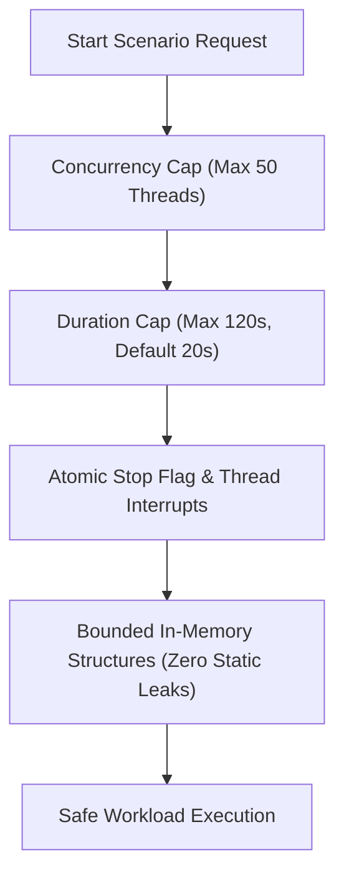

# Demo Lab: Scenario Catalog & Safety Guarantees

`jfr-performance-demo-app` (ShopSphere) is a Spring Boot e-commerce demo application engineered to generate realistic, isolated, and safe JVM performance anti-patterns on local developer machines.

---

## The 10 Performance Anti-Patterns

| ID | Name | Dominant JFR Event | Root Cause Summary |
| :--- | :--- | :--- | :--- |
| [`cpu-hotspot`](cpu-hotspot.md) | **CPU Hotspot** | `jdk.ExecutionSample` | Redundant trigonometric polynomial discount calculations |
| [`thread-contention`](thread-contention.md) | **Thread Contention** | `jdk.JavaMonitorEnter` | Coarse synchronized monitor locking across unrelated inventory |
| [`allocation-and-gc`](allocation-and-gc.md) | **Allocation Pressure** | `jdk.ObjectAllocationSample` | Churn of intermediate maps, DTOs, and string concatenation |
| [`allocation-and-gc`](allocation-and-gc.md) | **GC Pressure** | `jdk.GarbageCollection` | Burst allocations triggering rapid Eden exhaustion and young GCs |
| [`thread-pool-starvation`](thread-pool-starvation.md) | **Thread Pool Starvation** | `jdk.ThreadPark` | 2-worker executor queue starvation blocking caller threads |
| [`slow-io`](slow-io.md) | **Slow Downstream I/O** | `jdk.ThreadPark` (Low CPU) | Synchronous blocking downstream calls with near-zero CPU |
| [`exception-storm`](exception-storm.md) | **Exception Storm** | `jdk.JavaExceptionThrow` | Using thrown exceptions for routine validation control flow |
| [`serialization-overhead`](serialization-overhead.md) | **Serialization Overhead** | `jdk.ExecutionSample` / Alloc | Multiple Jackson JSON roundtrips during response assembly |
| [`other-scenarios`](other-scenarios.md#1-lock-scope-with-io-lock-and-io) | **Lock Scope with I/O** | `jdk.JavaMonitorEnter` + I/O | Holding shared monitor lock across simulated network calls |
| [`other-scenarios`](other-scenarios.md#2-jvm-heap-sizing-comparison-jvm-configuration) | **JVM Sizing Comparison** | Memory MXBean / GC | Memory pool occupancy and GC behavior under varying heap sizes |

---

## Safety and Bounded Workload Guarantees

To ensure scenarios never destabilize developer workstations, `jfr-performance-demo-app` implements four strict safety boundaries:



1. **Bounded Concurrency:** Worker pools are hard-capped at a maximum of 50 threads. Default demo runs use 4–8 threads.
2. **Bounded Duration:** Scenarios terminate automatically after a configured timeout (default 15–20s; maximum 120s). Workloads cannot run indefinitely in the background.
3. **Graceful Cancellation:** Every scenario loop checks an atomic cancellation flag and handles thread interrupts immediately via `scenario.stop()` or `POST /api/scenarios/{id}/stop`.
4. **Heap Safety:** Workloads generate memory churn but do **not** leak references into unbounded static collections. Memory is always reclaimable by garbage collection.
5. **Zero External Dependencies:** Runs purely locally on developer machines without requiring PostgreSQL, Kafka, Redis, or cloud accounts.

---

## Two Execution Modes

### Mode A: Standalone Workload Runner (Recommended for Demos)
Runs a complete faulty-versus-corrected benchmark with automatic JFR recordings and markdown report generation:

```bash
cd jfr-performance-demo-app
./scripts/run-demo.sh <scenario-id> [durationSeconds] [concurrency]
```

### Mode B: Interactive Spring Boot HTTP Server
Runs the application as an interactive REST microservice on port 8080:

```bash
java -jar target/jfr-performance-demo-app-1.0.0-SNAPSHOT.jar
```

Key REST API endpoints:
- `GET /api/scenarios`: Lists all scenarios and current run status
- `POST /api/scenarios/{id}/start?mode=FAULTY&durationSeconds=20&concurrency=8`: Starts a scenario
- `POST /api/scenarios/{id}/stop`: Stops a running scenario immediately
- `GET /api/metrics/summary`: Returns JVM memory usage and latency percentiles
- `POST /api/jfr/start?scenarioId=cpu-hotspot&mode=faulty`: Starts in-process JFR recording
- `POST /api/jfr/stop`: Flushes and saves the recording to `recordings/`
